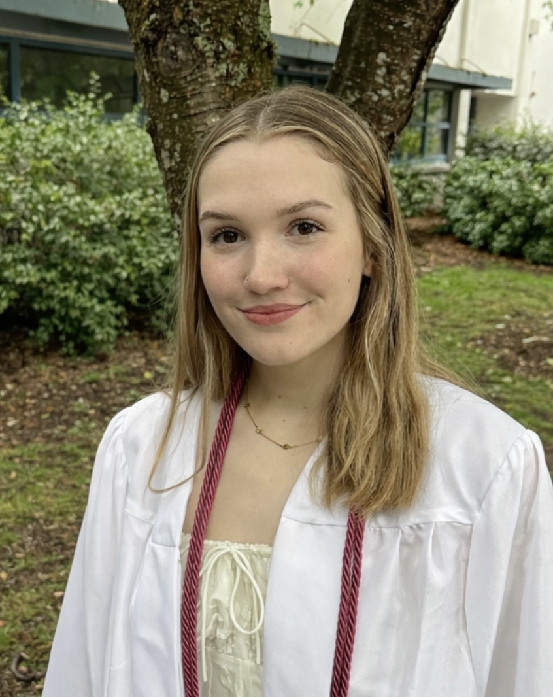

::: {.columns}

::: {.column width="30%"}
{width=90%}

{width=90%}
:::

::: {.column width="70%"}
## About Me

My name is Julia Laney and I'm a senior studying Quantitative Economics and Statistical & Data Sciences at Smith College. I am interested in business analytics, AI, and using data analysis to inform economic policy.

I'm from Seattle, Washington and outside of school I enjoy hiking, video games, and sports.

Email: jlaney@smith.edu

Phone: (206) 422-5809

[GitHub](https://github.com/julialaney)

[LinkedIn](https://www.linkedin.com/in/julia-laney-4a092a34a)
:::

:::